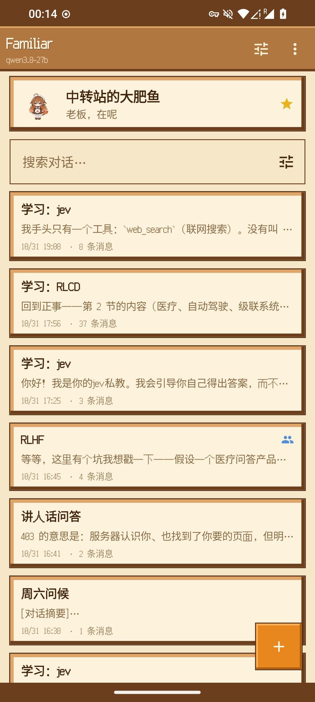
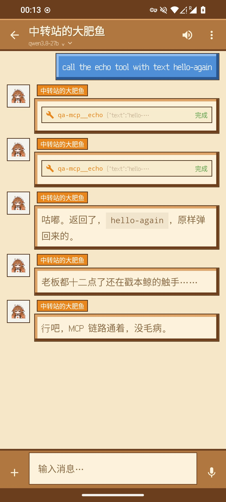
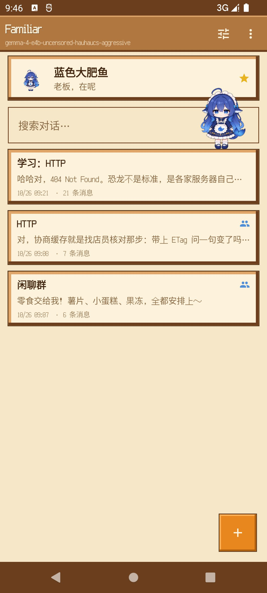
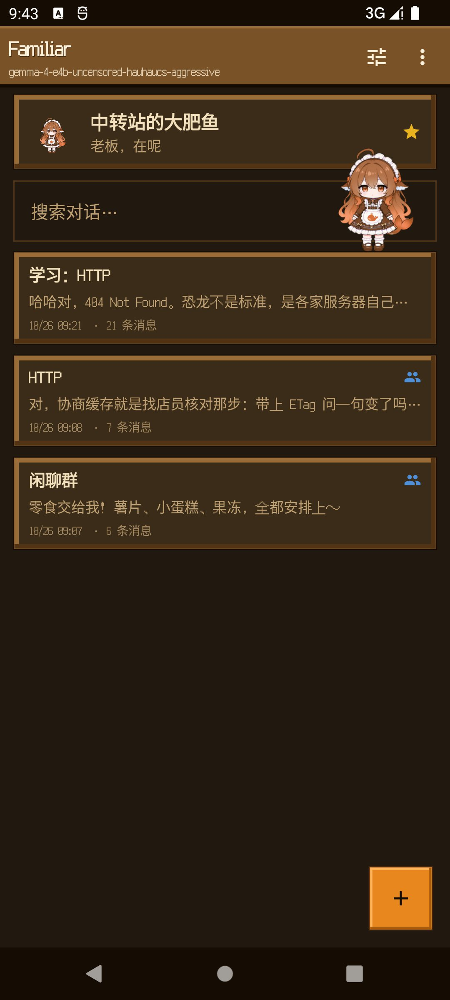
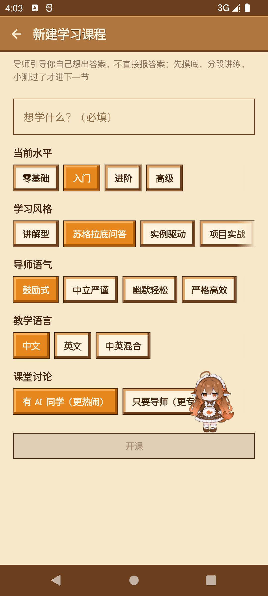
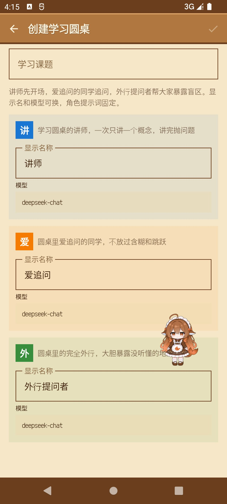
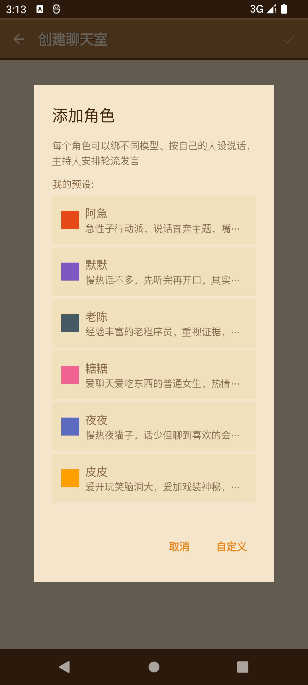
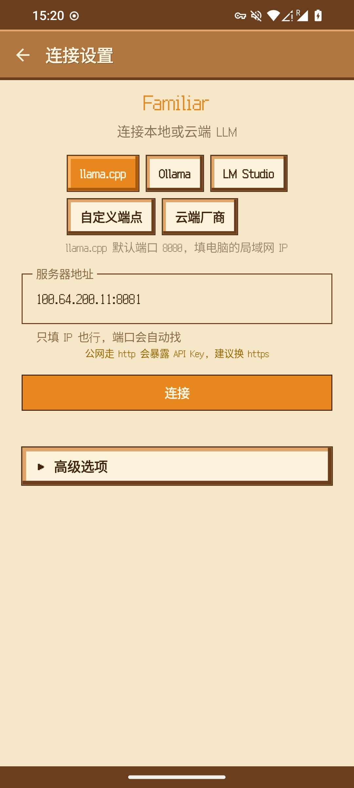
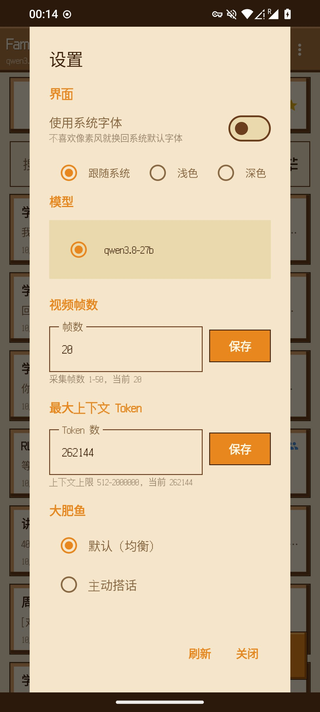

English | [中文](README.md)

# Familiar

A big fat fish living in your phone. Familiar is an Android client for local LLMs built around AI companionship: it connects to your own Ollama, llama.cpp, LM Studio, or any OpenAI-compatible cloud provider. Your main companion, the big fat fish, chats with you day-to-day with her own persona and memory, and turns into a desktop pet right on your screen. You can also pull a group of characters into a chat room or a study roundtable. All chats, attachments, and settings stay on your device — nothing goes through any third-party server (the only exception: optional web search sends search terms to the search engine — see Privacy).

[](https://github.com/liuyouwu1999/familiar/releases)
[](LICENSE)

-green)

[Download](#download) · [Features](#features) · [Screenshots](#screenshots) · [Build from source](#build-from-source) · [Contributing](#contributing) · [License](#license)

## Download

Get the latest `Familiar-<version>.apk` from the [Releases](https://github.com/liuyouwu1999/familiar/releases) page. Every release ships with a `SHA256SUMS.txt` checksum file.

Requires Android 8.0 (API 26) or later.

Access to GitHub may require workarounds in mainland China.

Note: in-app update checks depend on the release asset name `Familiar-<version>.apk` and tag `v<version>`. Please keep them unchanged.

## Features

The big fat fish (main companion):

- Fixed persona: Blue Big Fat Fish / Relay-Station Big Fat Fish (Claude orange), switched together with the pet color; artwork and personality come from the community project codex-deepseek-pet. What she calls you is customizable (default: "Boss")
- Desktop pet: once a model is connected, she sits on your screen — tap to interact, double-tap for confetti, long-press for a menu (open chat / head pat / cold joke / hide), flick her away for a comeback, dozes off when the app loses focus. Position is remembered; optional overlay mode (off by default) keeps her floating above other apps
- Layered memory: stable facts (conservatively extracted and deduplicated) + interaction log (one line per turn), accumulated and recalled automatically — she gets to know you over time. Memory can be viewed, copied, and cleared behind a two-step confirmation
- Human-like pacing: replies are split into 2-4 short messages with reading-time delays and pauses, like a real person texting
- Three speaking modes: default / proactive / quiet-passive

Connection:

- Custom endpoints and cloud providers are separated: local backends (Ollama, llama.cpp, LM Studio) work with just an address; for cloud providers you pick a vendor, the official base URL is filled in automatically, and you only add an API key. 12 vendors with sample models built in
- LAN scanning to discover local servers automatically. API keys are encrypted with Android Keystore (AES-256-GCM); plain-http addresses get an explicit warning
- Model lists are fetched online; embedding models are filtered out

Attachments & input:

- Camera, gallery images, PDF documents, video frame sampling (1-50 frames, for vision models)
- Markdown reply rendering; voice input; TTS read-aloud (voice is transcribed by your configured server by default, falling back to the system speech service on failure)

Context management (KV-cache friendly):

- Per-conversation max context tokens (512-2000000), set to match your model's actual context (OpenAI-compatible endpoints generally don't report it), with automatic history trimming beyond the limit
- Anchored early trimming with hysteresis: boundaries move as little as possible; evicted messages degrade to byte-stable placeholder text
- System prompts stay byte-stable across turns, so llama.cpp / Ollama KV caches and remote prompt caches hit on the longest common prefix — the steadier the prefix, the higher the hit rate
- Context usage panel: messages / attachments / system prompt / reply headroom / remaining, plus cache hit rate

Learning features:

- Tutor classroom (study course): tailor your own class — four levels, learning styles (explanatory / Socratic / example-driven / project-based), tutor tone, and teaching language. The tutor follows a teaching loop: diagnostic first, then a `/plan` outline of 5-9 sections; each section covers exactly one concept and ends with a question, waiting for you to think first. Quizzes reveal one question at a time and never leak the answer in advance; when you're wrong, the tutor guides through a hint → partial explanation → worked example chain instead of giving it away. Progress is tracked on-device: section-by-section outline checkmarks, quiz score, and a weak-points list that grading feedback prioritizes — remembered across sessions
- Classroom discussion (optional): up to two AI classmates chime in — Xiao Ke, who always asks why, and A Sui, who loves obscure trivia. One short line at a time, never lecturing for the teacher, and they'll happily make the exact mistake you just made
- Command chips above the input bar: `/plan` study plan, `/start` start the lesson, `/test` quiz me, `/example` another example, `/progress` report progress
- Web verification: lessons and roundtables automatically search the web to verify version numbers, years and other time-sensitive facts; the big fat fish and chat rooms can enable the same from Settings (unofficial Bing China scraping that may break on layout changes; search terms are sent to Bing)
- Study roundtable: pick a topic and three roles discuss it around the table — the lecturer covers one concept at a time and throws out a question, the inquisitive classmate presses on anything vague, and the complete outsider exposes blind spots with everyday analogies
- Plain-language mode: explain complex ideas in everyday words

Chat rooms:

- Free-form group chat with 2-4 characters, each bound to its own model and persona, hosted turn by turn
- Six built-in "realistic" presets (A-Ji / Mo-Mo / Lao Chen / Tang-Tang / Ye-Ye / Pi-Pi): chatting comes first, persona second — replies vary in length, small talk is fine, and characters talk to each other instead of orbiting the user
- What room characters call you is configured separately and does not affect the big fat fish

Data:

- Everything stays on device (Room database), with search, pinning, and Markdown export
- Full JSON backup & restore; backups never contain API keys

Other:

- Pixel-art UI (Ark Pixel font; switch to the system font in settings); three theme modes (follow system / light / dark)
- In-app update checks (daily, optional; GitHub Releases + SHA-256 verification before install)

No analytics, ads, or tracking SDKs. Apart from GitHub API calls for update checks, the app makes no other external requests.

## Screenshots

| Session list | Fish chat | Blue big fat fish | Dark theme |
|:---:|:---:|:---:|:---:|
|  |  |  |  |

Learning features (tutor classroom & study roundtable):

| Course setup | Tutor classroom | Roundtable setup | Roundtable discussion |
|:---:|:---:|:---:|:---:|
|  |  |  |  |

Chat rooms:




Connection & settings:





## Build from source

You need Android Studio, JDK 17+, and the Android SDK (compileSdk 34). Minimum supported version is Android 8.0.

```bash
git clone https://github.com/liuyouwu1999/familiar.git
cd familiar
./gradlew :app:assembleDebug
```

Without `keystore.properties` the build falls back to debug signing, so a fresh clone builds out of the box. For release signing, provide your own keystore following the signing config in `app/build.gradle.kts`.

Run unit tests: `./gradlew :app:testDebugUnitTest`.

## Contributing

Issues for bugs and feature requests are welcome. For PRs, please open an issue first to discuss the approach; commit messages should follow [Conventional Commits](https://www.conventionalcommits.org/en/v1.0.0/).

## Privacy

All data stays on your device. No analytics, ads, or tracking SDKs:

- Chats, memory, attachments, and settings live only on your phone; uninstalling removes everything (backup files are yours to keep)
- Network requests fall into three kinds: your own configured LLM server; GitHub Releases for update checks; and web search — lessons and roundtables may always trigger it; the big fat fish and chat rooms only when "web search" is enabled in Settings. Search terms are sent to Bing China
- The overlay pet (optional, off by default) requires the "display over other apps" permission solely to show the pet; it reads nothing from other apps
- Voice input is transcribed by the server you configured (whisper-compatible endpoint) when available, falling back to the system speech service; audio never reaches the developer

## Free, do not resell

Familiar is completely free. The only official distribution channels are this repository and its [Releases](https://github.com/liuyouwu1999/familiar/releases) page.

Any app store, website, or individual selling, bundling, or otherwise charging for this software is fraudulently impersonating the developer. Never pay for it; if you encounter such cases, please report them to the platform or open an [Issue](https://github.com/liuyouwu1999/familiar/issues).

## Disclaimer

This software is provided "as is", without warranty of any kind, express or implied. To the maximum extent permitted by law, the developer is not liable for any direct or indirect losses arising from the use or inability to use this software.

This app is only a chat client. Models are served by your own server or the cloud provider you choose; you are responsible for the accuracy and compliance of generated content, in accordance with local laws and regulations.

## Third-party components

| Component | Purpose | License |
|---|---|---|
| Jetpack Compose / AndroidX (Room, DataStore, Navigation, etc.) | UI & framework | Apache-2.0 |
| [OkHttp](https://github.com/square/okhttp) / okhttp-sse | Networking & SSE streaming | Apache-2.0 |
| [Gson](https://github.com/google/gson) | JSON parsing | Apache-2.0 |
| [Coil](https://github.com/coil-kt/coil) | Image loading | Apache-2.0 |
| [pdfbox-android](https://github.com/TomRoush/PdfBox-Android) | PDF attachment rendering | Apache-2.0 |
| [compose-markdown](https://github.com/jeziellago/compose-markdown) | Markdown rendering | MIT |
| [Ark Pixel Font](https://github.com/TakWolf/ark-pixel-font) | Pixel UI font | OFL 1.1 |
| [dsh-humanized-deepseek-maid](https://github.com/loonai321/dsh-humanized-deepseek-maid) | Reference for the companion engine (layered memory, human-like pacing) | MIT |
| [codex-deepseek-pet](https://github.com/YunYueSama/codex-deepseek-pet) | The pet's artwork and animation frames, by YunYueSama (orange palette is a recolored derivative by this project; full license text in NOTICE) | [Big Fat Fish Attribution License 1.0](https://github.com/YunYueSama/codex-deepseek-pet) |
| [dsh-deepseek-pet](https://github.com/txlznbzsdj-collab/dsh-deepseek-pet) | Pet interaction design reference (tap lines, confetti, flick comeback, dozing; no code or assets copied) | MIT (design reference only) |
| [Kyaa-A/eli5](https://github.com/Kyaa-A/eli5) | Rule design ported for the ELI5 mode | MIT |
| [OpenMAIC](https://github.com/THU-MAIC/OpenMAIC) | Tutoring mechanism reference (teaching loop, no-spoiler quizzing, role trio) | MIT |
| [Mr. Ranedeer AI Tutor](https://github.com/JushBJJ/Mr.-Ranedeer-AI-Tutor) | Reference for tutor config dimensions & command system | MIT |

All third-party components are copyrighted by their respective authors. Thanks to the open-source community.

## License

This project is licensed under [GNU GPL v3](LICENSE). Derivative works must be licensed under the same terms with copyright notices preserved.

Copyright © 2026 Familiar Dev
