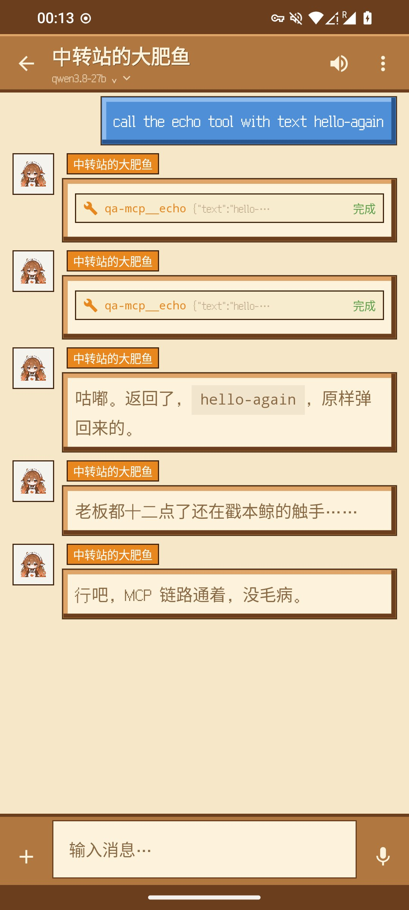
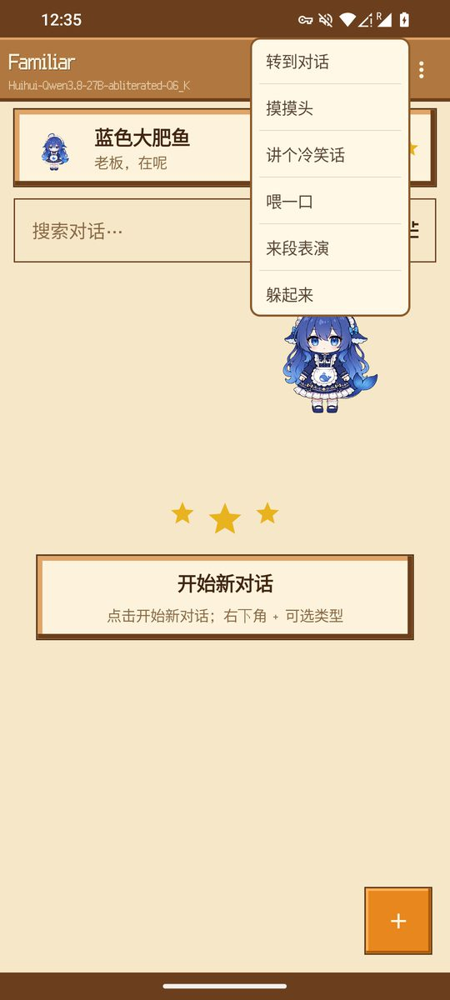
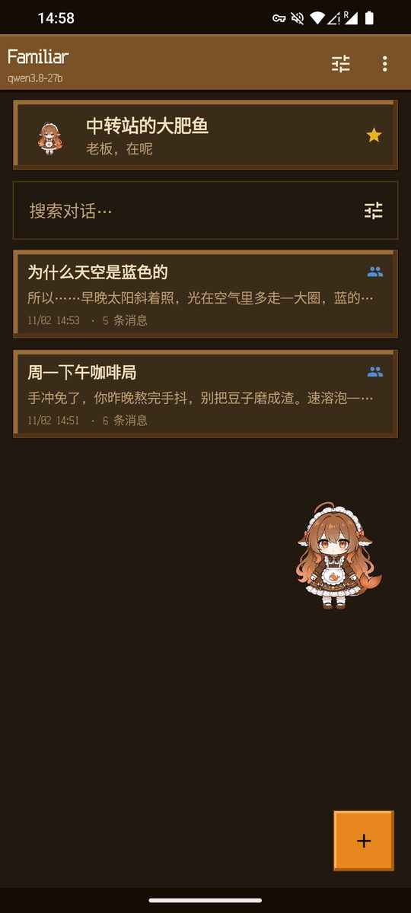
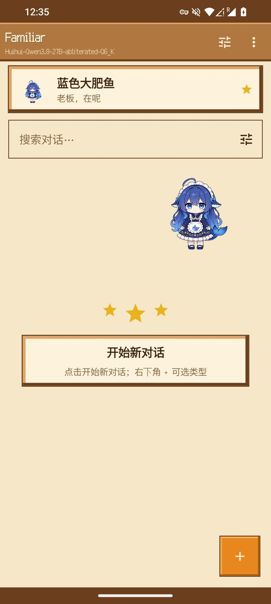
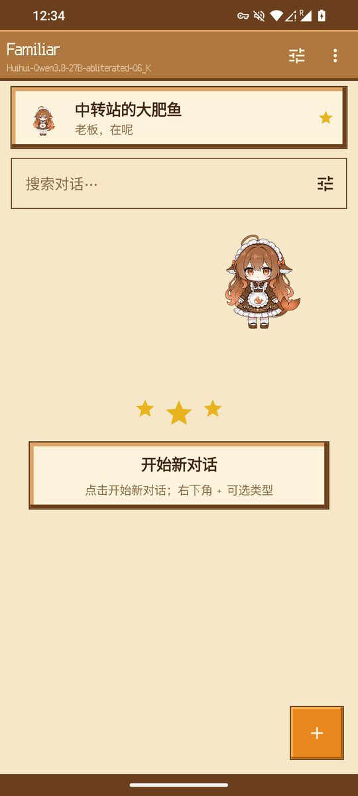
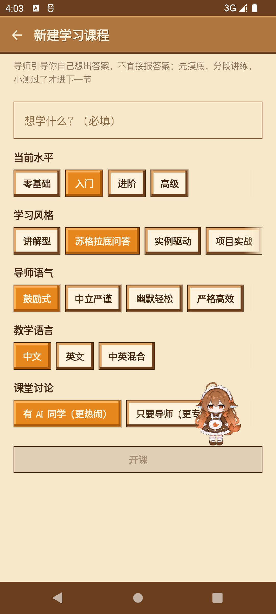
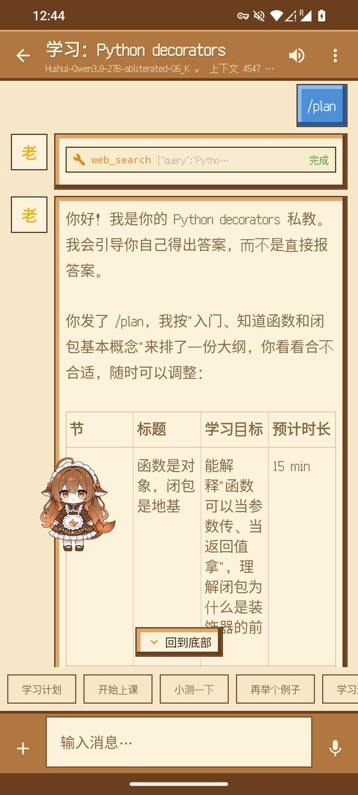
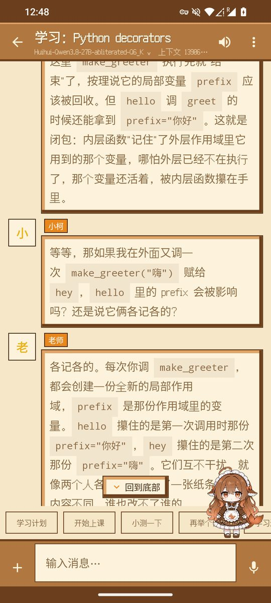
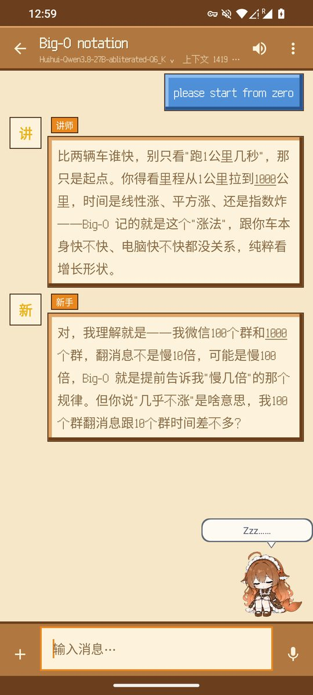
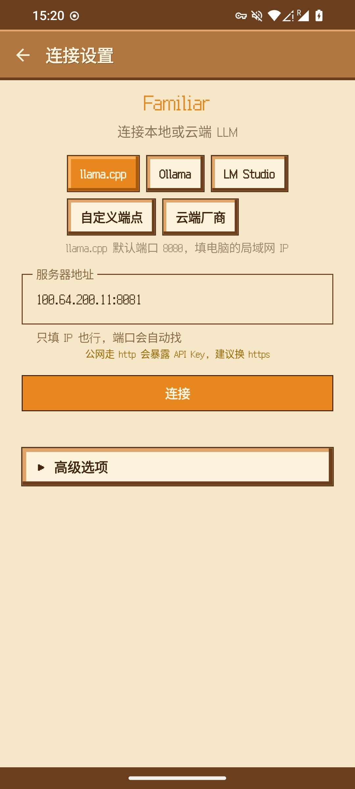

<div align="center">


# Familiar

**住在你手机里的大肥鱼**

[](https://github.com/liuyouwu1999/familiar/releases)
[](LICENSE)

-green)

[中文](README.md) | [English](README.en.md)

Familiar 是一个以拟人陪伴为主的 Android 本地大模型客户端：连接你自己运行的 Ollama、llama.cpp、LM Studio 或任意 OpenAI 兼容云端厂商。主陪伴大肥鱼带着人设与记忆陪你日常聊天，连上模型后变成桌宠待在屏幕上；也能拉一群角色开闲聊群、组学习圆桌。聊天记录、附件与配置全部保存在设备本地，不经过任何第三方服务器。

[下载](#下载安装) · [功能](#功能) · [界面预览](#界面预览) · [从源码构建](#从源码构建) · [参与贡献](#参与贡献) · [许可证](#许可证)

</div>

## 界面预览

**桌宠与陪伴** —— 连上模型后大肥鱼常驻屏幕；回复按句界拆成多条短消息，像真人一句一句说。

<p align="center">
  
  
  
  
</p>

**皮肤配色** —— 两套皮肤：「蓝色大肥鱼」与「中转站的大肥鱼（Claude 橘）」，悬浮窗、会话卡片与头像整体换色。

<p align="center">
  
  
</p>

**教学功能** —— 导师课堂按教学循环推进，学习圆桌三角色互相追问。

<p align="center">
  
  
  
  
</p>

**群聊与连接** —— 真人卡闲聊群；填个地址就连上你自己跑的本地大模型。

<p align="center">
  
  
</p>

## 下载安装

前往 [Releases](https://github.com/liuyouwu1999/familiar/releases) 页面下载最新 `Familiar-<版本>.apk`，每个 Release 附有 `SHA256SUMS.txt` 校验和，下载后可以比对。

系统要求 Android 8.0（API 26）及以上。

中国大陆网络环境访问 GitHub 可能需要自行解决可达性。

注意：应用内检查更新依赖 Release 资产命名 `Familiar-<版本>.apk` 与 tag `v<版本>`，请勿变更。

## 功能

### 大肥鱼（主陪伴）

- **固定人设**：蓝色大肥鱼 / 中转站的大肥鱼（Claude 橘），随桌宠配色整体切换，形象与性格来自社区二创项目 codex-deepseek-pet；对你的称呼可自定义（默认「老板」）
- **桌宠**：连上模型后大肥鱼待在屏幕上——单击互动、双击撒花、长按菜单（转到对话/摸摸头/冷笑话/躲起来）、甩远吐槽、失焦打盹；位置拖动记忆；可选后台悬浮（默认关，浮在其他应用上面）
- **分层记忆**：稳定事实（从你的自我披露中保守抽取去重）+ 互动记录（每轮一行），随对话自动沉淀、按需召回，越聊越懂你；记忆查看、复制、两级确认后清空
- **拟人节奏**：回复按句界分成 2-4 条短消息，带阅读节奏的首条延迟与段间停顿，像真人一样一句一句说
- **说话模式三选**：默认 / 主动搭话 / 安静被动

### 连接

- **本地后端与云端厂商分离**：本地后端（Ollama、llama.cpp、LM Studio）填地址即用；云端厂商选厂家自动填官方地址，只需再填 API Key，内置 12 家厂商与示例模型
- **只填 IP 也行**：没填端口会先试后端的常用端口，再自动扫描扩展端口段，找到就连上；也可以用局域网扫描列出网内所有服务器手动挑
- **连接诊断**：地址、认证、模型、回复四步红绿灯，失败自动展开，哪步红了修哪步
- **密钥加密**：API Key 经 Android Keystore（AES-256-GCM）加密保存，不存明文；明文 http 地址有明确风险提示
- **模型列表在线获取**，嵌入模型自动过滤

### 附件与输入

- **多模态附件**：拍照、相册图片、PDF 文档、视频帧采集（1-50 帧可调）；图片以 OpenAI 兼容格式直接进模型，配视觉模型（llama.cpp mmproj、Qwen-VL 等）即可看图说话
- **语音**：语音输入转文字；TTS 朗读回复（语音默认发给您配置的服务器转写，失败自动回退系统语音识别）
- **插话与排队**：生成中也能发消息——直接发送是插话，导师/角色读到你这条后接着回应；长按发送则排队追问，回复完自动把你的问题发给模型（输入栏上方有排队横幅，可一键取消）
- **Markdown 渲染**回复

### 上下文管理（KV cache 友好设计）

- **每会话最大上下文 Token 可设**（512-2000000），按所用模型的实际上下文自行设定（OpenAI 兼容接口普遍不上报该值，无法自动感知），超限自动裁剪历史消息
- **锚定式提前裁剪 + 滞后滑动**，边界尽量不动；被挤出的消息降级为字节级稳定的占位文本
- **系统提示词跨轮字节稳定**——本地 llama.cpp / Ollama 的 KV 缓存与远端 prompt cache 按最长公共前缀命中，前缀越稳命中越高、越省算力
- **上下文容量面板**：消息 / 附件 / 系统提示词 / 回复预留 / 剩余分类统计，含缓存命中率；聊天顶栏也常驻显示——生成中是 token 计数与速率（思考段计入），空闲时显示上次请求的真实上下文占用

### 教学功能

- **导师课堂（学习课程）**：定制你的课堂——水平四档、学习风格（讲解型 / 苏格拉底问答 / 实例驱动 / 项目实战）、导师语气与教学语言。导师按教学循环推进：先摸底再开课，`/plan` 生成 5-9 节大纲；每节只讲一个概念、讲完就发问，等你先想；小测一次只出一题、绝不提前泄题，答错不直接给答案，按「提示 → 部分解释 → 完整示范」逐级引导。学习进度由客户端记录：大纲逐节打勾、小测战绩、薄弱点清单，讲评时优先针对，跨会话不忘
- **课堂讨论（可选）**：最多两位 AI 同学插话——爱问为什么的小柯、爱举冷知识的阿穗。只插一句嘴，不替老师讲课，还会恰好在你错的同一个地方犯典型小错
- **输入栏命令 chips**：`/plan` 学习计划、`/start` 开始上课、`/test` 小测一下、`/example` 再举个例子、`/progress` 学习进度；每节开讲（/start）前自动联网查证本节主题，讲解直接锚在搜索结果上
- **联网查证**：课堂与圆桌讲到版本号、年份等易过时事实时自动联网搜索验证；大肥鱼与聊天室可在设置开启同一能力。搜索为多源聚合——必应中国、360、搜狗、维基百科（中英文条目自动补位），结果交错去重（各源为网页抓取的非官方用法，可能随改版失效；搜索词会发往这些搜索源，设置里可测试）
- **学习圆桌**：定一个课题，讲师、爱追问、外行提问者三角色围桌讨论——讲师一次只讲一个概念、讲完抛问题，爱追问专挑含糊处质问，外行用生活比喻暴露盲区
- **讲人话模式**：把复杂概念用大白话解释，恒开联网查证，不拿过时知识当查证结论

### 聊天室（闲聊群）

- **2-4 个角色自由群聊**，每个角色可绑不同模型、按自己的人设说话，主持人安排轮流发言
- **内置六张「真人卡」预设**（阿急 / 默默 / 老陈 / 糖糖 / 夜夜 / 皮皮）：先正常聊天再考虑人设，长短不固定、允许接不上话，不围着用户转、角色之间互相接话
- **称呼独立**：群里角色对你的称呼单独设置，与大肥鱼的称呼互不影响

### 数据

- **仅存本机**（Room 数据库），支持搜索、置顶、Markdown 导出
- **JSON 全量备份与恢复**，备份不含 API Key

### 其他

- **像素风界面**（Ark Pixel 字体，不喜欢可在设置切换系统字体）；深浅色三选（跟随系统 / 浅色 / 深色）
- **应用内检查更新**（每天自动一次，可关；GitHub Releases + SHA-256 校验后才安装）

本应用不接入统计、广告或上报 SDK。除检查更新访问 GitHub API 外，不发出任何其他对外请求。

## 从源码构建

需要 Android Studio、JDK 17+ 与 Android SDK（compileSdk 34），最低支持 Android 8.0。

```bash
git clone https://github.com/liuyouwu1999/familiar.git
cd familiar
./gradlew :app:assembleDebug
```

没有 `keystore.properties` 时构建自动降级为 debug 签名，克隆下来就能构建。要做正式签名，参照 `app/build.gradle.kts` 里的签名配置自行提供密钥库。

跑单元测试：`./gradlew :app:testDebugUnitTest`。

## 参与贡献

欢迎提 Issue 反馈 bug 和功能建议。PR 请先开 Issue 讨论方案，提交信息建议遵循 [Conventional Commits](https://www.conventionalcommits.org/zh-hans/)。

## 隐私

数据全部保存在设备本地，本应用不接入任何统计、广告或上报 SDK：

- 对话、记忆、附件与设置只存在你的手机上，卸载应用即全部删除（备份文件由你自行保管）
- 网络请求只有三类：连接你自己配置的 LLM 服务器；检查更新时访问 GitHub Releases；联网搜索——课堂与圆桌始终可能触发，开启「大肥鱼与聊天室联网搜索」后大肥鱼与聊天室也会触发，搜索词会发往所用搜索源（必应中国 / 360 / 搜狗 / 维基百科）
- 后台悬浮（可选，默认关闭）需要系统「显示在其他应用上层」权限，仅用于展示桌宠，不读取其他应用的任何内容
- 语音输入默认由您配置的服务器（whisper 兼容端点）转写，不可用时回退系统语音识别；音频不经过本应用的开发者

## 完全免费，禁止倒卖

Familiar 完全免费，官方发布渠道只有本仓库和仓库的 [Releases](https://github.com/liuyouwu1999/familiar/releases) 页面。

任何应用商店、网站或个人以付费形式销售、捆绑或变相收费分发本软件，都是冒用开发者名义的诈骗，与开发者无关。请不要付费下载；遇到了欢迎向发布渠道举报，或者提 [Issue](https://github.com/liuyouwu1999/familiar/issues) 告知。

## 免责声明

本软件按「现状」提供，不附带任何明示或默示的担保。在法律允许的最大范围内，开发者不对您因使用或无法使用本软件造成的任何直接或间接损失承担责任。

本软件只是对话客户端，模型由你自己部署的服务器或选择的云端厂商提供，生成内容的准确性与合规性由所用模型与使用者自行负责，请遵守所在地区的法律法规。

## 第三方组件

| 组件 | 用途 | 许可证 |
|---|---|---|
| Jetpack Compose / AndroidX（Room、DataStore、Navigation 等） | UI 与基础框架 | Apache-2.0 |
| [OkHttp](https://github.com/square/okhttp) / okhttp-sse | 网络与 SSE 流式 | Apache-2.0 |
| [Gson](https://github.com/google/gson) | JSON 解析 | Apache-2.0 |
| [Coil](https://github.com/coil-kt/coil) | 图片加载 | Apache-2.0 |
| [pdfbox-android](https://github.com/TomRoush/PdfBox-Android) | PDF 附件渲染 | Apache-2.0 |
| [compose-markdown](https://github.com/jeziellago/compose-markdown) | Markdown 渲染 | MIT |
| [Ark Pixel Font](https://github.com/TakWolf/ark-pixel-font) | 像素风界面字体 | OFL 1.1 |
| [dsh-humanized-deepseek-maid](https://github.com/loonai321/dsh-humanized-deepseek-maid) | 拟人陪伴引擎机制参考与移植（分层记忆/拟人节奏等） | MIT |
| [codex-deepseek-pet](https://github.com/YunYueSama/codex-deepseek-pet) | 桌宠"大肥鱼"的形象与动画帧，作者 YunYueSama（橘色系为本项目重着色衍生，许可全文见 NOTICE） | [大肥鱼项目署名许可 1.0](https://github.com/YunYueSama/codex-deepseek-pet) |
| [dsh-deepseek-pet](https://github.com/txlznbzsdj-collab/dsh-deepseek-pet) | 桌宠交互设计参考（单击台词/双击庆祝/甩远吐槽/失焦打盹等，未复制代码与素材） | MIT（仅设计参考） |
| [Kyaa-A/eli5](https://github.com/Kyaa-A/eli5) | 讲人话（ELI5）模式规则设计移植 | MIT |
| [OpenMAIC](https://github.com/THU-MAIC/OpenMAIC) | 导师课堂/学习圆桌教学机制参考（教学循环/防泄题/角色三件套） | MIT |
| [Mr. Ranedeer AI Tutor](https://github.com/JushBJJ/Mr.-Ranedeer-AI-Tutor) | 课堂配置维度与命令系统参考 | MIT |

以上组件的版权归各自作者所有，感谢开源社区。

## 许可证

本项目以 [GNU GPL v3](LICENSE) 协议开源。衍生作品需要以同协议开源并保留版权声明。

Copyright © 2026 Familiar Dev
